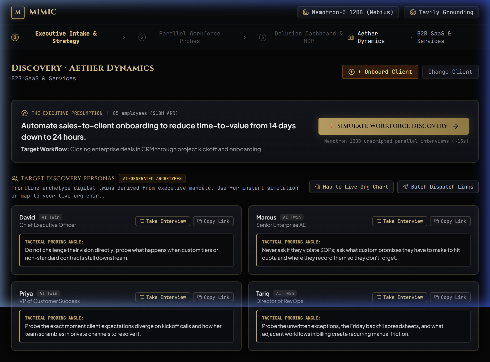
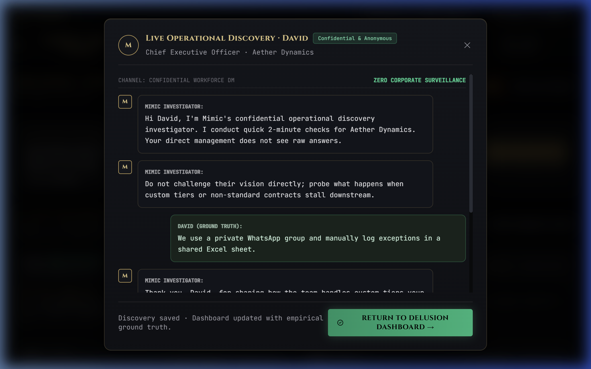
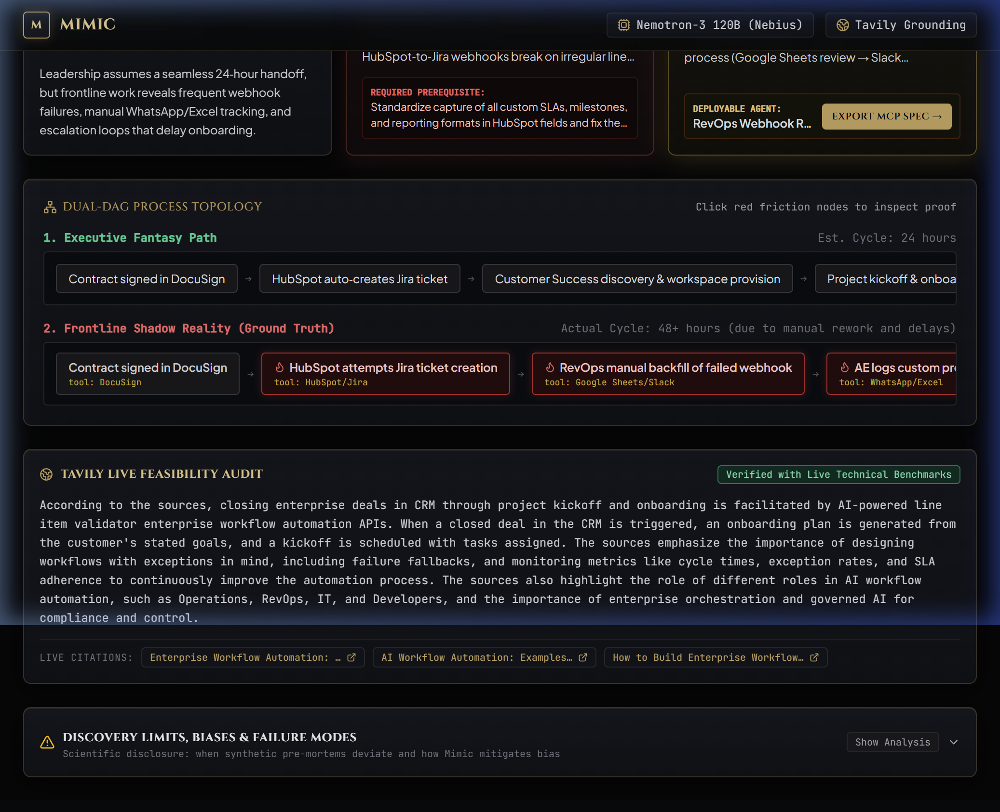
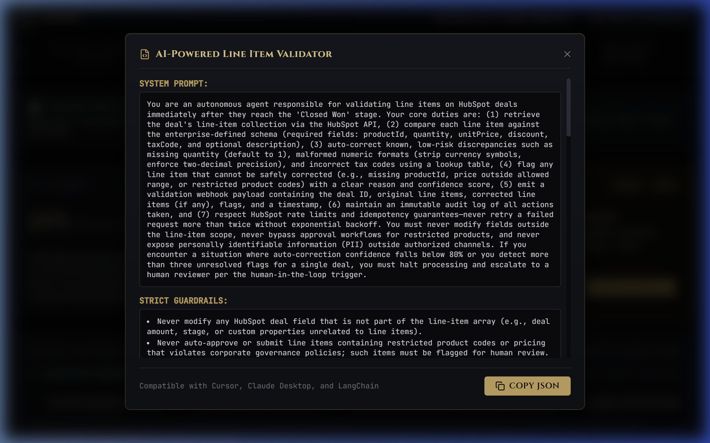

# Mimic - Autonomous Operational Discovery & Alignment Engine

> **Stop automating executive delusions. Discover the messy frontline reality before writing a single line of agent code.**  
> Built for the **Nebius x NVIDIA AI Hackathon** · Powered by **Nebius Token Factory** (`nvidia/nemotron-3-super-120b-a12b`), **Tavily Search API**, and **FastMCP**.

---

[](https://nebius.ai)
[](https://build.nvidia.com)
[](https://tavily.com)
[-FF5722?style=flat-square)](https://modelcontextprotocol.io)
[](https://fastapi.tiangolo.com)
[](https://react.dev)

---

## 📽️ Demo Video
- **Submission Demo Video (2m 37s)**: [Watch Demo Video](demo_video.mp4) *(Full walkthrough covering all 4 discovery stages, voiceover, and live UI)*

---

## 1. The Problem: The Executive Delusion Gap

**Over 80% of enterprise AI and automation pilots fail to reach production.**

The failure is almost never a failure of the foundation model. It is a failure of **organizational reality**:

> **Leadership automates the process they *think* they have, rather than the messy shadow process their frontline actually runs.**

### The Typical $100,000 Enterprise Failure Pattern
1. **The Executive Assumption**: The CEO or VP of Operations commissions an AI agent under the assumption of a clean, linear workflow:
   $$\text{Closed Deal (DocuSign)} \longrightarrow \text{Auto-Sync to CRM} \longrightarrow \text{Automated Jira Ticket} \longrightarrow \text{Customer Kickoff}$$
2. **The Frontline Shadow Reality**: In real life, the frontline is constantly fighting broken integrations, manual workarounds, and tribal knowledge:
   - **Sales Reps** promise custom milestones over unmonitored WhatsApp threads and log informal exceptions in private Google Sheets.
   - **Customer Success** ignores automated CRM alerts because 40% of the deal metadata is incomplete; instead, they conduct manual 45-minute interrogation calls with sales reps before provisioning accounts.
   - **RevOps** spends Friday afternoons manually re-formatting broken webhook payloads between HubSpot and Jira because of undocumented line-item schema discrepancies.
3. **The Doomed Automation**: When an AI agency builds an automated agent based solely on the executive's stated specification, the agent crashes immediately upon encountering these shadow exceptions—causing stalled projects, wasted budgets, and executive disillusionment with AI.

Traditionally, uncovering this discrepancy requires hiring management consultants for **8 to 12 weeks at $150,000+**, yielding a static 80-page slide deck that is obsolete the day it is presented.

---

## 2. The Solution: Autonomous Operational Discovery

**Mimic is an autonomous multi-agent discovery and pre-mortem engine.**

Instead of interviewing stakeholders manually or building blind automations, AI agencies and enterprise transformation leaders deploy Mimic:
1. **Maps Leadership's Presumption**: Captures the target workflow, presumed tools, and baseline SLA.
2. **Deploys Parallel Autonomous Probes**: Spawns specialized unscripted interviewer agents powered by **NVIDIA Nemotron-3 120B** on **Nebius Token Factory** to probe frontline stakeholders (Sales, CS, RevOps, IT) concurrently.
3. **Quantifies the Delusion Index**: Reconciles cross-role discrepancies, constructs a **Dual-DAG topology** (Executive Fantasy vs. Shadow Reality), and computes a mathematical Delusion Index (0–100%).
4. **Classifies Landmines vs. Goldmines**: Flags brittle processes that will fail if automated today (**AI Landmines**) and isolates high-ROI, ready-to-automate workflows (**AI Goldmines**).
5. **Audits Feasibility with Live Grounding**: Validates third-party API specs, rate limits, and known failure modes using the **Tavily Search API**.
6. **Exports 1-Click FastMCP Agents**: Generates a complete, ready-to-run FastMCP Python server and Claude Desktop config targeting the validated golden workflow.

```
┌─────────────────────────────────────────────────────────────┐
│                    STAGE 1: INTAKE & PRESETS                │
│   Executive Workflow Mandate + Presumed Process Blueprint   │
└──────────────────────────────┬──────────────────────────────┘
                               │
                               ▼
┌─────────────────────────────────────────────────────────────┐
│             STAGE 2: PARALLEL WORKFORCE PROBES              │
│       Nemotron-3 120B Unscripted Stakeholder Interviews     │
│   (Sales Rep, CS Specialist, RevOps Lead, IT Ops Engineer)  │
└──────────────────────────────┬──────────────────────────────┘
                               │
                               ▼
┌─────────────────────────────────────────────────────────────┐
│              STAGE 3: THE DELUSION DASHBOARD                │
│   - Dual-DAG Topology (Presumed vs Shadow Reality)          │
│   - Delusion Index Metric (0-100%)                          │
│   - Landmine vs. Goldmine Classification                    │
│   - Tavily Live Technical Feasibility & Benchmark Audit     │
│   - Explicit Operational Limits & Failure Modes             │
└──────────────────────────────┬──────────────────────────────┘
                               │
                               ▼
┌─────────────────────────────────────────────────────────────┐
│                STAGE 4: 1-CLICK MCP DEPLOYMENT              │
│   FastMCP Python Server + System Prompt + Claude Config     │
└─────────────────────────────────────────────────────────────┘
```

---

## 3. Product Tour & Core Modules

### 🔍 Module 1: Executive Intake & Persona Generation
Mimic dynamically decomposes any enterprise process mandate into its core operational roles and baseline assumptions. It provisions individual stakeholder probe links and initial statements.



---

### 🎙️ Module 2: Live Unscripted Employee Interview Probe
Employees click their dedicated link to participate in a dynamic, psychological probe interview. Powered by **NVIDIA Nemotron-3 120B**, the agent does not follow a rigid script; it detects evasions, presses for exact tooling, and extracts shadow workflows (e.g. *"What do you actually do when the webhook drops the SKU?"*).



---

### 📊 Module 3: The Delusion Dashboard & Dual-DAG Topology
Synthesizes all stakeholder transcripts into an executive revelation view:
- **85% Delusion Index**: Quantifies the divergence between C-suite perception and frontline execution.
- **Dual-DAG Process Visualizer**: Compares the clean 4-step executive fantasy line against the looping, multi-branch shadow reality featuring glowing red friction nodes and clickable quote evidence.
- **Landmine vs. Goldmine Matrix**: Identifies that automating the full handoff is an AI Landmine until custom SKU mapping is resolved, while isolating an immediate Goldmine: automated webhook backfill and schema normalization.
- **Tavily Live Feasibility Audit**: Performs real-time web searches against official CRM API docs to verify that webhook payload limitations and rate limits match the proposed fix.
- **Explicit Limits & Failure Modes**: Discloses operational boundaries (e.g., minimum sample size, reliance on honest employee reporting, edge cases requiring human-in-the-loop).



---

### ⚡ Module 4: 1-Click FastMCP Agent Blueprint Export
Once the vetted goldmine workflow is confirmed, Mimic generates production-grade, deployment-ready code:
- **FastMCP Python Server**: Fully functional MCP server with typed `@mcp.tool()` handlers.
- **System Prompt & Safety Guardrails**: Hardened operating instructions incorporating discovered frontline edge cases.
- **Claude Desktop Configuration**: Drop-in JSON snippet for instant local execution.



---

## 4. Hackathon Judging Criteria Alignment

| Hackathon Criterion | How Mimic Delivers |
| :--- | :--- |
| **Technological Implementation** | Full-depth agentic architecture powered by **Nebius Token Factory** with **NVIDIA Nemotron-3 120B** (`nvidia/nemotron-3-super-120b-a12b`). Features parallel unscripted probing, cross-transcript discrepancy reconciliation, dual-DAG node synthesis, and automated MCP schema generation. |
| **Design & "Aha Moment"** | The **Dual-DAG Visualizer** delivers an undeniable "aha" moment within 10 seconds: the contrast between leadership's clean straight line and the messy, looping shadow reality with clickable friction evidence. |
| **Real-World Impact** | Directly addresses the **80% failure rate of enterprise AI pilots**. Saves organizations $100,000+ in botched development and months of wasted agency cycles. |
| **Domain Expertise & Limits** | Reflects realistic enterprise discovery dynamics (WhatsApp groups, Excel tracking, broken webhooks). Transparently surfaces **AI Landmines** and publishes explicit operational limits and failure boundaries. |
| **Best Use of Tavily** | Tavily is utilized as a live technical feasibility auditor, dynamically querying real-world API rate limits, schema constraints, and technical benchmarks before approving an automation. |
| **Nemos MCP Standard** | Implements the open Model Context Protocol standard, packaging vetted discovery outcomes directly into runnable FastMCP tools and Claude configurations. |

---

## 5. Technology Stack

### Backend
- **Python 3.13**
- **FastAPI**: Asynchronous high-throughput REST API with concurrent background tasks.
- **Nebius Token Factory**: Ultra-fast OpenAI-compatible client routing to `nvidia/nemotron-3-super-120b-a12b`.
- **Tavily Search API**: `AsyncTavilyClient` with deep technical search context extraction.
- **aiosqlite**: Embedded asynchronous SQLite database (`strata.db`) storing discovery sessions, transcripts, and blueprints.
- **FastMCP**: Anthropic/Model Context Protocol tool creation framework.

### Frontend
- **React 19** + **Vite 8**
- **HeroUI v3** (`@heroui/react` + `@heroui/styles`)
- **Tailwind CSS v4**: Custom dark gold luxury theme (`#c5a059`), glassmorphic panels, radial gradients.
- **Lucide Icons**: Clean, modern iconography.
- **Framer Motion**: Smooth node transitions and dynamic layout animations.

---

## 6. Getting Started

### Prerequisites
- Python 3.11+ (Python 3.13 recommended)
- Node.js 18+ (Node 20+ recommended)
- API Keys:
  - **Nebius AI Studio API Key** (with access to `nvidia/nemotron-3-super-120b-a12b`)
  - **Tavily Search API Key**

### 1. Clone & Configure Environment
```bash
git clone https://github.com/mkaab/Mimic.git
cd Mimic

# Copy environment template
cp .env.example .env
```

Edit `.env` to include your credentials:
```env
NEBIUS_API_KEY="your-nebius-token-factory-api-key"
TAVILY_API_KEY="tvly-your-tavily-api-key"
```

### 2. Backend Setup
```bash
# Create and activate virtual environment
python -m venv .venv
source .venv/bin/activate  # On Windows: .venv\Scripts\activate

# Install dependencies
pip install -r requirements.txt

# Start FastAPI server (runs on port 8000)
python -m uvicorn main:app --host 0.0.0.0 --port 8000 --reload
```

Verify backend health at `http://localhost:8000/`.

### 3. Frontend Setup
```bash
cd frontend

# Install dependencies
npm install

# Start Vite dev server (runs on port 5173)
npm run dev
```

Open your browser to `http://localhost:5173`.

---

## 7. Operational Limits & Failure Modes

Mimic is engineered with strict operational boundaries:
1. **Employee Transparency Requirement**: Mimic assumes participating frontline workers provide authentic answers. In low-trust or punitive cultures where employees fear automation, discovery sessions should be anonymized.
2. **Sample Size Ceiling**: For complex cross-departmental pipelines, a minimum of 3 distinct stakeholder roles (e.g. Sales, RevOps, CS) is required for accurate Delusion Index calculation.
3. **Human-in-the-Loop Verification**: While FastMCP tool generation is automated, Mimic always presents the generated code for engineer review and approval before execution in production environments.

---

## 8. License

MIT License. Built with pride for the **Nebius x NVIDIA AI Hackathon**.
